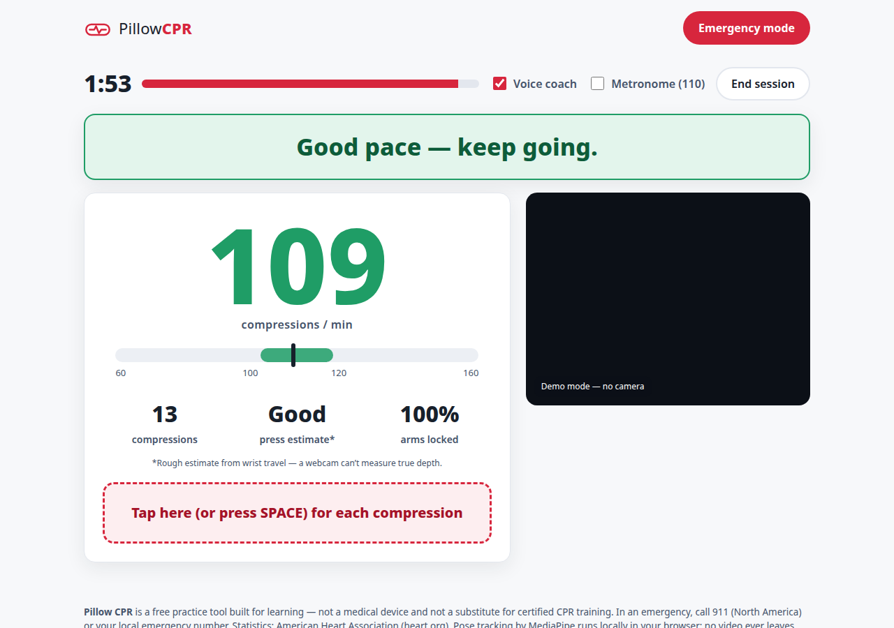
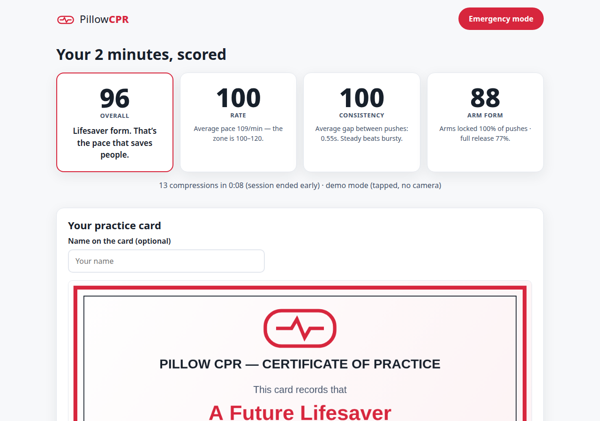
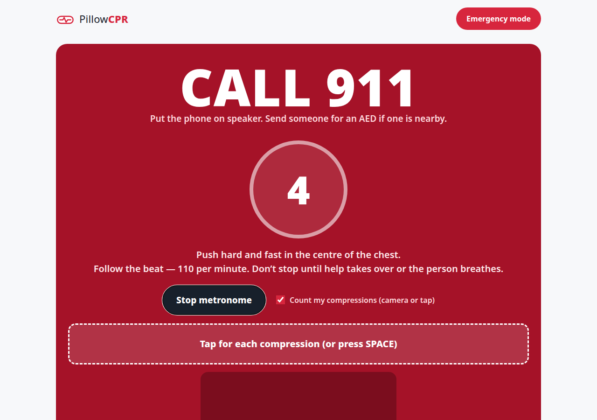

# Pillow CPR

**Anyone can learn CPR in 2 minutes — with a pillow.**


Pillow CPR is a browser app that coaches hands-only CPR through your webcam, using a
pillow as the practice dummy. Pose tracking follows your shoulders and wrists, counts
every compression in real time, and corrects you out loud — *"faster," "lock your
elbows," "let it come all the way up."* A 2-minute session ends with a score for rate,
consistency and arm form, plus a shareable practice card. A separate emergency mode
skips the scoring: it says **call 911**, then runs a loud 110-beat metronome and counts
your compressions while you work.

**▶ Live demo: https://alenzacodes.github.io/pillow-cpr/**

No install, no account, no backend. Your camera feed never leaves your device — the
pose model runs entirely in your browser tab.

---

## Why

Most people have never practiced CPR, and when someone collapses, bystanders freeze or
push too slowly. A course takes hours and money; a pillow and a laptop camera are free.

- Immediate CPR can **double or triple** a cardiac arrest victim's chance of survival.
- Only about **1 in 10** people who suffer cardiac arrest outside a hospital survive —
  most never receive CPR in time.
- The target is **100–120 compressions per minute**, arms straight, letting the chest
  come all the way back up between pushes.

*Statistics: American Heart Association, Hands-Only CPR fact sheet (heart.org).*

## What it does

1. **Set up** — pillow on the floor, kneel behind it, laptop in front. Live framing
   checks confirm your shoulders and hands are in view.
2. **Practice (2 minutes, scored)** — MediaPipe Pose tracks your wrists; the
   up-and-down cycle of wrist position becomes the compression count. A voice coach
   (Web Speech API) corrects rate, elbow lock and recoil live, with a big on-screen
   rate gauge whose green zone is 100–120/min.
3. **Score + practice card** — rate, consistency and arm form scored out of 100, and a
   certificate-style PNG card you can download and share.
4. **Emergency mode** — "CALL 911" first, then a loud WebAudio metronome at 110 BPM, a
   giant compression counter, and a spoken count every 10 compressions.
5. **Demo mode** — no camera? Tap or press the spacebar per compression; the same
   coaching and scoring pipeline runs. (Built for judges, classrooms, and the shy.)

## How the counting works


- Each frame, the pose model returns body landmarks. Pillow CPR averages the two wrist
  heights and smooths them (exponential moving average).
- A rolling "top" reference (10th percentile of the last ~3 seconds) stands for
  hands-at-rest. Depth is wrist travel below that reference, normalised by shoulder
  width so it works at any distance from the camera.
- A small state machine (`UP → DOWN → RECOVERING`) turns that signal into strokes: a
  compression counts when the wrists drive down past a threshold and release back to
  the top. A release that stalls halfway is flagged as **incomplete recoil**.
- The elbow angle (shoulder–elbow–wrist) at the bottom of each stroke measures
  **arm lock**; the intervals between stroke bottoms give **rate**.
- Rate, steadiness (interval variation) and form combine into the final score:
  40% rate, 30% consistency, 30% form.

## Honest limits

- **This is a practice tool, not a medical device, and the card is not a
  certification.** Take a certified course — the American Heart Association and the
  Heart and Stroke Foundation run them everywhere.
- A webcam measures **rate and arm form reliably**. True compression **depth cannot be
  measured** from a flat camera image, so the app shows press depth as a *rough
  estimate* and says so on screen.
- In a real emergency, call 911 first. Emergency mode is a metronome and a counter,
  not a dispatcher.

## Tech

- Vanilla HTML/CSS/JavaScript — no build step, no framework, no backend.
- [MediaPipe Pose](https://developers.google.com/mediapipe) (CDN) for on-device pose tracking.
- Web Speech API for the voice coach · WebAudio API for the metronome.
- Canvas API for the score card · GitHub Pages for hosting.

## Run it locally

```bash
python3 -m http.server 8000
# open http://localhost:8000  (camera requires localhost or HTTPS — both fine)
```

Then click **Start the 2-minute practice**, allow the camera, and press a pillow.

## Screenshots

| Practice HUD | Score + practice card | Emergency mode |
|---|---|---|
|  |  |  |

## Built for

Next Byte Hacks V5 (Devpost) — solo build. Judging criterion: **Impact**.

## License

MIT — see [LICENSE](LICENSE). Learn CPR, then teach someone else.
